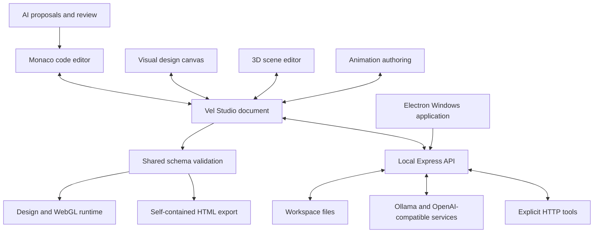

# Vel Studio architecture

## One application, one document



## Layers

| Layer | Responsibility | Boundary |
| --- | --- | --- |
| Shared document | Validation, pure editing operations, timeline sampling, button actions | Does not read files or call a provider |
| UI authoring | Selection, drag/resize, property controls, undo/redo, file buffers | Emits source changes; Save persists them |
| 3D engine | Scene graph, WebGL, camera, gizmos, runtime behaviors | Runtime state does not overwrite the source document |
| Export player | Interactive UI and scene from an embedded document | No IDE API or external network needed |
| Backend | Persistence, exports, credentials and configured service requests | Loopback listener, host/origin checks, bounded text files |
| Desktop | Window lifecycle and bundled local server | Renderer has no Node.js access |

## File map

```text
desktop/main.cjs             Desktop window and local backend lifecycle
shared/studio.js             Canonical schema and immutable transformations
shared/engine.js             Reusable Three.js engine
src/main.jsx                 IDE shell, files, AI and plugin UI
src/studio/StudioWorkbench.jsx Visual design, scene inspector, animation authoring
src/studio/SceneViewport.jsx  React engine adapter
src/studio/studio.css         Studio styling
runtime/player.js            Standalone design and scene player
server/studio.js             Source-to-HTML packaging
server/generated/player.js   Bundled offline runtime (generated)
server/preview.js            Legacy UI DSL and studio preview dispatch
server/app.js                Local API
server/providers.js          AI transports and prompt contract
server/store.js              Filesystem boundaries and encrypted secrets
scripts/build-runtime.mjs    Build offline player with esbuild
scripts/package-desktop.mjs  Package Windows desktop folder
test/                       Node tests using isolated data and mock services
```

## Data flow

A visual edit creates a new document value, serializes it and updates the active source buffer. The saved-file baseline remains separate so unsaved changes are visible. Code editing follows the same path. Validation protects the visual editors and runtime from malformed source. Runtime animations sample a copy; gameplay simulates transient state. Save writes the source through the existing bounded workspace API.

The HTML exporter embeds the validated document and a bundled JavaScript runtime. The document JSON escapes `<` so user text cannot close its data script. The IDE preview additionally uses an isolated iframe and network-blocking policy.

## AI and tools

An AI provider is an adapter, not the project source of truth. Only the opted-in current file is added to model context. Returned source requires review before application. HTTP plugins run only on user input and do not receive the project automatically. These APIs can be extended later with additional protocols without changing the document format.

## Desktop persistence

Browser mode uses `.vel-data` beside the project. Desktop mode stores its workspaces and encrypted settings under Electron's application user-data directory, inside `studio-data`. This keeps writable data out of the packaged application. The desktop backend uses an ephemeral loopback port and shuts down with the application.

## Current engine scope

The engine renders primitives, supports material color and opacity, orbit controls, editable transforms, spin/bob/player behaviors, and gravity against one infinite horizontal ground. It does not implement mesh import, arbitrary colliders, a full rigidbody solver, skeletal animation, shader authoring or native platform code generation.
